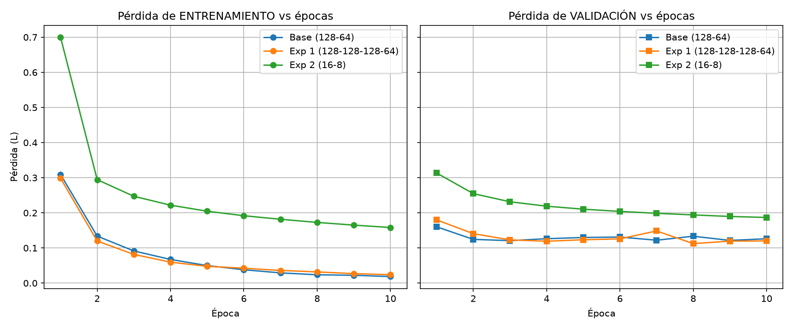
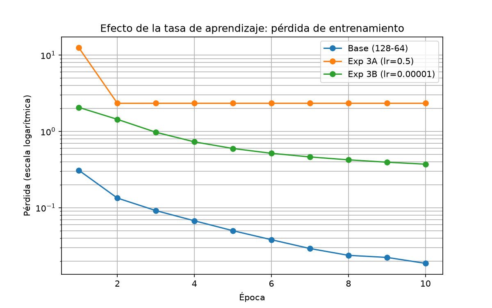
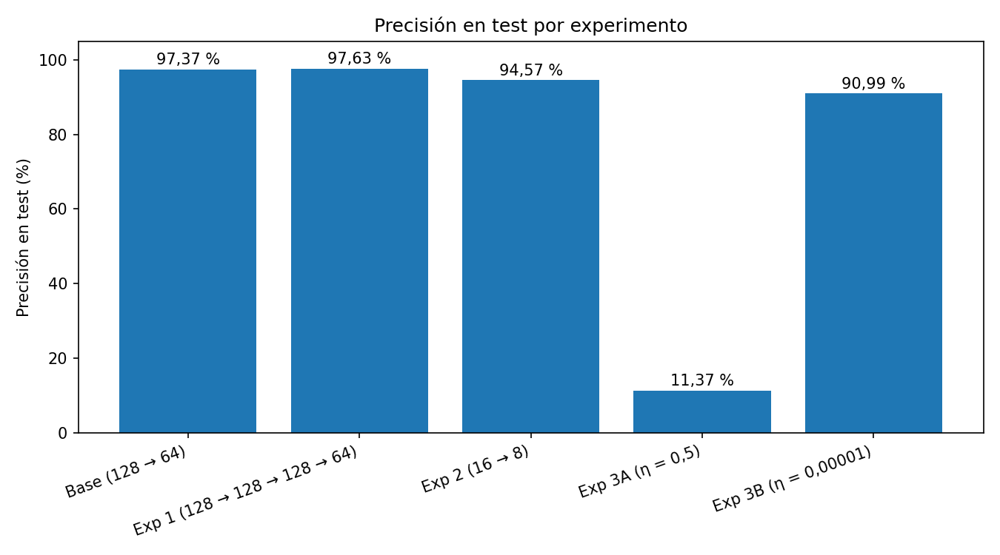

# Reporte técnico RA2: Efecto de hiperparámetros en un MLP (MNIST)

**Asignatura**: Inteligencia Artificial

**Estudiante:** Milton Vanegas Delgado

**Docente:** Ing. Oscar F. Pulgarin

**Resultado de Aprendizaje (RA)**: RA2 Diseñar e implementar modelos de redes neuronales artificiales profundas para la resolución de problemas complejos mediante algoritmos de aprendizaje supervisado.

**Modelo Implementado**: Multilayer Perceptron (MLP) sobre dataset MNIST

**Entorno de Ejecución**: Python 3.11 \| TensorFlow 2.16.2 / Keras 3 \| VS Code / Warp \| CPU Intel (MacBook Air 2015)

**GitHub**: https://github.com/mvanegasgh/INTELIGENCIA-ARTIFICIAL/tree/main/taller_DL_MLP

## 1. Introducción y metodología

Este reporte mide cómo cambian el error y la precisión de un perceptrón multicapa (MLP) al modificar un solo hiperparámetro a la vez: la profundidad, el ancho y la tasa de aprendizaje. El modelo base alcanza 97,37 % de precisión en test; el peor caso, con η = 0,5, cae a 11,37 %.

**Problema.** Clasificar dígitos escritos a mano del dataset MNIST (60.000 imágenes de entrenamiento y 10.000 de prueba, de 28 × 28 píxeles, clases del 0 al 9). Los píxeles se normalizan dividiéndolos entre 255.

**Modelo base.** Entrada aplanada de 784 valores, capa oculta de 128 neuronas (ReLU), capa oculta de 64 neuronas (ReLU) y salida de 10 neuronas (Softmax). Tiene 109.386 parámetros.

**Condiciones fijas en todos los experimentos:**

- Optimizador Adam (η = 0,001, salvo en el Experimento 3).
- Pérdida: entropía cruzada categórica esparsa.

- 10 épocas, lote de 64 imágenes.
- 20 % del entrenamiento reservado para validación (12.000 imágenes).

- Semilla aleatoria fija (42) antes de construir cada modelo, para que todos partan de la misma aleatoriedad.
- Entorno: Python 3.11 con TensorFlow 2.16.2 / Keras 3, ejecutado en la CPU de un MacBook Air 2015 (Intel).

**Experimentos.** Cada uno cambia una sola cosa respecto al modelo base:

| Experimento | Cambio                   | Capas ocultas        | η       |
|-------------|--------------------------|----------------------|---------|
| Base        | Ninguno                  | 128 → 64             | 0,001   |
| Exp 1       | Más profundidad          | 128 → 128 → 128 → 64 | 0,001   |
| Exp 2       | Menos neuronas           | 16 → 8               | 0,001   |
| Exp 3A      | Tasa de aprendizaje alta | 128 → 64             | 0,5     |
| Exp 3B      | Tasa de aprendizaje baja | 128 → 64             | 0,00001 |

**Código.** El código completo está en el repositorio indicado arriba: mlp_unintep_lab.py (modelo base) y experimento_1.py (los cinco experimentos, la tabla comparativa y las tres figuras).

## 2. Marco teórico: Machine Learning tradicional vs Deep Learning

La diferencia central es quién construye las características de entrada: en Machine Learning tradicional las define una persona; en Deep Learning las aprende la propia red.

**Feature Engineering (ML tradicional).** Algoritmos como la regresión logística, los árboles de decisión o las SVM necesitan que un ingeniero transforme los datos brutos x en atributos útiles φ(x) antes de clasificar. Para MNIST habría que definir a mano bordes, trazos o curvas, y el resultado depende del conocimiento del dominio.

**Representation Learning (Deep Learning).** La red recibe los píxeles brutos y aprende una jerarquía de transformaciones no lineales encadenadas: cada capa toma la salida de la anterior y la convierte en una representación más útil para la tarea (Chollet, 2021).

$$z^{(1)} = W^{(1)}a^{(0)} + b^{(1)},\quad a^{(1)} = ReLU\left( z^{(1)} \right)$$

$$z^{(2)} = W^{(2)}a^{(1)} + b^{(2)},\quad a^{(2)} = ReLU\left( z^{(2)} \right)$$

$$z^{(3)} = W^{(3)}a^{(2)} + b^{(3)},\quad\widehat{y} = Softmax\left( z^{(3)} \right)$$

Aquí a⁽⁰⁾ es la imagen aplanada (784 valores), W son los pesos, b los sesgos y ReLU(z) = max(0, z). Sin una activación no lineal, apilar capas equivaldría a una sola transformación lineal; por eso hace falta una activación como ReLU.

**Por qué conviene aprender jerarquías.** Chollet (2021) describe los datos de entrada como un manifold plegado, una «bola de papel» arrugada en la que las clases quedan entrelazadas. Cada capa aplica una transformación continua que la desarruga un poco, hasta que la última solo necesita separar las clases con una frontera lineal. En imágenes, las primeras capas suelen captar bordes, las siguientes formas y las últimas objetos, sin que nadie programe esos atributos. Además, el rendimiento de las redes profundas sigue mejorando al aumentar los datos y el cómputo (GPU o TPU), mientras que el de los modelos tradicionales tiende a alcanzar una meseta.

**Salida y pérdida.** Softmax convierte las 10 salidas en una distribución de probabilidad cuya suma es 1, y la pérdida es la entropía cruzada categórica esparsa, que penaliza la poca probabilidad asignada a la clase correcta:

$$Softmax(z)_{i} = \frac{e^{z_{i}}}{\sum_{j = 1}^{10}e^{z_{j}}},\quad\quad L = - \frac{1}{m}\sum_{k = 1}^{m}\log{\widehat{y}}_{k,y_{k}}$$

**Cómo aprende la red.** En cada lote la red calcula la salida y la pérdida L (paso hacia adelante), propaga el error hacia atrás con la regla de la cadena (backpropagation) para obtener el gradiente de L respecto a los pesos, y el optimizador actualiza los parámetros. Los experimentos usan Adam, que reescala el gradiente. El tamaño de cada paso es del orden de η sin importar cuán grande o pequeño sea el gradiente, y en la primera actualización cada peso se mueve aproximadamente η en la dirección que reduce la pérdida. Por eso η es el hiperparámetro que más pesa en la estabilidad del entrenamiento, como muestra el Experimento 3.

**Parámetros del modelo base.** Cada capa densa tiene (entradas × neuronas) + sesgos parámetros:

| Capa     | Cálculo           | Parámetros |
|----------|-------------------|------------|
| Oculta 1 | (784 × 128) + 128 | 100.480    |
| Oculta 2 | (128 × 64) + 64   | 8.256      |
| Salida   | (64 × 10) + 10    | 650        |
| Total    |                   | 109.386    |

**Cómo se relaciona con los experimentos.** La profundidad (Experimento 1) es el número de transformaciones encadenadas; el ancho (Experimento 2) es cuánta información puede llevar cada representación; y la tasa de aprendizaje (Experimento 3) es el tamaño del paso con que se ajustan W y b en la actualización (en Adam, del orden de η).

**Referencia.** Chollet, F. (2021). *Deep Learning with Python* (2.ª ed.), capítulos 1 y 2.

## 3. Modelo base (128 → 64)

El modelo base acierta el 97,37 % de las imágenes de test, pero muestra un sobreajuste leve: su pérdida de entrenamiento (0,0186) es casi siete veces menor que la de validación (0,1263).

| Métrica                             | Valor   |
|-------------------------------------|---------|
| Parámetros                          | 109.386 |
| Tiempo de entrenamiento             | 34,0 s  |
| Pérdida de entrenamiento (época 10) | 0,0186  |
| Pérdida de validación (época 10)    | 0,1263  |
| Pérdida en test                     | 0,1117  |
| Precisión en test                   | 97,37 % |

La pérdida de entrenamiento baja de forma continua durante las 10 épocas, mientras que la de validación deja de mejorar hacia la segunda época y se mantiene entre 0,12 y 0,13, muy por encima de la de entrenamiento (0,0186 en la época 10). Esa separación entre ambas curvas indica que la red empieza a memorizar ejemplos de entrenamiento en lugar de seguir generalizando. Aun así, la precisión en test sigue siendo alta.

*Figura 1. Pérdida de entrenamiento (izquierda) y de validación (derecha) por época: modelo base, Experimento 1 (profundidad) y Experimento 2 (capacidad).*

## 4. Experimento 1: efecto de la profundidad

Añadir dos capas ocultas de 128 neuronas aumentó los parámetros un 30 % y el tiempo de entrenamiento alrededor de un 11 %, sin producir una mejora ni un sobreajuste claros en 10 épocas.

**Configuración.** Se pasó de 128 → 64 a 128 → 128 → 128 → 64 neuronas, sin cambiar nada más.

| Métrica                             | Base    | Exp 1   |
|-------------------------------------|---------|---------|
| Parámetros                          | 109.386 | 142.410 |
| Tiempo de entrenamiento             | 34,0 s  | 37,7 s  |
| Pérdida de entrenamiento (época 10) | 0,0186  | 0,0240  |
| Pérdida de validación (época 10)    | 0,1263  | 0,1202  |
| Brecha validación − entrenamiento   | 0,108   | 0,096   |
| Precisión en test                   | 97,37 % | 97,63 % |

**¿Aumentó el tiempo de entrenamiento?** Sí, pero poco: de 34,0 s a 37,7 s con 33.024 parámetros adicionales. Más capas implican más operaciones por cada lote. La diferencia (3,7 s) es del mismo orden que la que hay entre los modelos con la arquitectura del base (31,3 s a 34,2 s), así que conviene leerla con cautela.

**¿Se evidencia sobreajuste?** No de forma clara. La brecha entre la pérdida de validación y la de entrenamiento es incluso algo menor que en el base (0,096 frente a 0,108), y la precisión en test es 0,26 puntos mayor. En la Figura 1, las curvas de entrenamiento del base y del modelo profundo casi se superponen, y la pérdida de validación de ambos oscila entre 0,11 y 0,15 sin una tendencia que los separe.

Cada configuración se entrenó una sola vez con una única semilla; una diferencia de 0,26 puntos cabe dentro de lo que cambiaría con otra inicialización, así que no se puede atribuir a la profundidad. Para concluirlo habría que repetir con varias semillas.

*Ver la Figura 1 (sección 3): la curva naranja es el Experimento 1.*

## 5. Experimento 2: capacidad neuronal

Reducir las capas ocultas a 16 y 8 neuronas produce subajuste: el modelo tiene un 88 % menos de parámetros y pierde 2,8 puntos de precisión en test (94,57 % frente a 97,37 %).

**Configuración.** Capas ocultas de 16 y 8 neuronas. El modelo pasa de 109.386 a 12.786 parámetros.

| Métrica                             | Base    | Exp 2   |
|-------------------------------------|---------|---------|
| Parámetros                          | 109.386 | 12.786  |
| Tiempo de entrenamiento             | 34,0 s  | 22,7 s  |
| Pérdida de entrenamiento (época 10) | 0,0186  | 0,1583  |
| Pérdida de validación (época 10)    | 0,1263  | 0,1869  |
| Brecha validación − entrenamiento   | 0,108   | 0,029   |
| Precisión en test                   | 97,37 % | 94,57 % |

**¿Ocurre subajuste?** Sí, por tres señales:

1.  El error es alto también en entrenamiento: 0,1583, unas 8,5 veces el del base. Si la red no aprende bien ni los ejemplos que practica, el problema es su tamaño.
2.  La brecha entre validación y entrenamiento es pequeña (0,029 frente a 0,108), lo que descarta el sobreajuste.

3.  La curva de pérdida sigue bajando en la época 10, es decir, aprende despacio y con más épocas mejoraría algo, pero la capacidad limita el resultado.

La causa probable es la capa de 8 neuronas, que actúa como cuello de botella: la imagen de 784 valores se comprime primero a 16 números y luego a 8 antes de decidir entre 10 clases, y en esa compresión se pierde información.

No es un fracaso total. Con solo 12.786 parámetros el modelo acierta el 94,57 % y entrena más rápido (22,7 s). Para tareas donde importa el costo de cómputo, esa relación entre tamaño y precisión puede ser aceptable.

## 6. Experimento 3: tasa de aprendizaje (η)

Con η = 0,5 la red colapsó al nivel del azar (11,37 % en test) y con η = 0,00001 aprendió, pero tan despacio que quedó en 90,99 %, más de seis puntos por debajo del base (η = 0,001).

**Configuración.** Se usó la arquitectura base (128 → 64) y solo se cambió la tasa de aprendizaje de Adam.

| Métrica                             | η = 0,001 (base) | η = 0,5 | η = 0,00001 |
|-------------------------------------|------------------|---------|-------------|
| Pérdida de entrenamiento (época 10) | 0,0186           | 2,3399  | 0,3721      |
| Pérdida de validación (época 10)    | 0,1263           | 2,3357  | 0,3426      |
| Pérdida en test                     | 0,1117           | 2,3317  | 0,3445      |
| Precisión en test                   | 97,37 %          | 11,37 % | 90,99 %     |

**η = 0,5: colapso.** La pérdida de entrenamiento fue 12,5 en la época 1 y desde la 2 quedó fija en 2,34, cerca de ln(10) ≈ 2,30: el error de una red que reparte la probabilidad por igual entre las 10 clases. La precisión (11,37 %) también queda cerca del 10 % del azar. No hubo oscilación; la pérdida pasó de muy alta a constante. Encaja con un paso tan grande (cercano a η = 0,5 por cada peso en Adam) que sobrepasó el mínimo y dañó los pesos desde las primeras actualizaciones. La explicación más probable es que muchas neuronas ReLU quedaron inactivas (salida cero y gradiente nulo) y el optimizador ya no pudo corregirlas; este reporte no lo comprobó.

**η = 0,00001: convergencia lenta.** Cada paso es tan pequeño que la pérdida baja de forma continua pero lenta. En 10 épocas llega a 0,3721, unas 20 veces lo que alcanza el base (0,0186), y no se estanca, de modo que con más épocas seguiría mejorando.

**¿Por qué una tasa alta desestabiliza y una baja estanca la convergencia?** La regla de actualización es $W_{\text{nuevo}} = W_{\text{viejo}} - \eta \cdot \nabla L$ (en Adam, el paso por peso es del orden de η), así que η fija cuánto se mueve cada peso en cada lote. Con η alto el paso se pasa del mínimo y puede dejar la pérdida peor que antes; en el Experimento 3A eso terminó en colapso y no en oscilación. Con η bajo el paso es tan corto que la pérdida baja de forma continua pero lenta, y harían falta muchas más épocas para llegar al mismo punto (en rigor, convergencia lenta más que estancamiento, porque la curva seguía bajando). Con 0,001 la red avanza rápido sin saltarse el mínimo.

*Figura 2. Pérdida de entrenamiento por época con η = 0,001 (base), η = 0,5 y η = 0,00001, en escala logarítmica.*

## 7. Comparación y conclusiones

De los tres hiperparámetros probados, la tasa de aprendizaje es el que más afecta el resultado: un valor mal elegido deja la red sin aprender (11,37 %), mientras que cambiar la profundidad o el ancho mueve la precisión entre 94,57 % y 97,63 %.

| Modelo                       | Parámetros | Tiempo (s) | Pérdida entrenamiento | Pérdida validación | Precisión test | Diagnóstico                      |
|------------------------------|------------|------------|-----------------------|--------------------|----------------|----------------------------------|
| Base (128 → 64)              | 109.386    | 34,0       | 0,0186                | 0,1263             | 97,37 %        | Sobreajuste leve                 |
| Exp 1 (128 → 128 → 128 → 64) | 142.410    | 37,7       | 0,0240                | 0,1202             | 97,63 %        | Sin diferencia clara con el base |
| Exp 2 (16 → 8)               | 12.786     | 22,7       | 0,1583                | 0,1869             | 94,57 %        | Subajuste                        |
| Exp 3A (η = 0,5)             | 109.386    | 31,3       | 2,3399                | 2,3357             | 11,37 %        | Colapso al nivel del azar        |
| Exp 3B (η = 0,00001)         | 109.386    | 34,2       | 0,3721                | 0,3426             | 90,99 %        | Convergencia lenta               |

*Figura 3. Precisión en test de los cinco modelos.*

**Conclusiones**

1.  **Profundidad.** Pasar de 2 a 4 capas ocultas aumentó los parámetros un 30 % y el tiempo un 11 %, sin una mejora ni un sobreajuste claros en 10 épocas.
2.  **Capacidad.** Con 16 y 8 neuronas hay subajuste: la pérdida es alta ya en entrenamiento y la brecha con validación es pequeña. El costo es de 2,8 puntos de precisión.

3.  **Tasa de aprendizaje.** η = 0,5 colapsó y η = 0,00001 convergió demasiado despacio. Solo el valor intermedio (0,001) llegó a una buena precisión en el mismo número de épocas.
4.  **Sobreajuste del modelo base.** La pérdida de validación deja de bajar mientras la de entrenamiento sigue cayendo. Detener el entrenamiento cuando la validación deja de mejorar (parada temprana) evitaría entrenar épocas que no aportan.

**Limitaciones**

- Cada configuración se entrenó una sola vez con una única semilla. Las diferencias pequeñas (como 0,26 puntos entre el base y el Experimento 1) no son concluyentes; las grandes (Experimentos 2 y 3) sí lo son.
- Los tiempos pueden variar entre ejecuciones por la carga del equipo, así que solo la comparación entre arquitecturas muy distintas es informativa.

- Se usaron 10 épocas en todos los casos. En el Experimento 2 y en η = 0,00001 la pérdida seguía bajando, por lo que más épocas las acercarían al base.
- La causa del colapso con η = 0,5 (neuronas ReLU inactivas) es una hipótesis que no se verificó.
